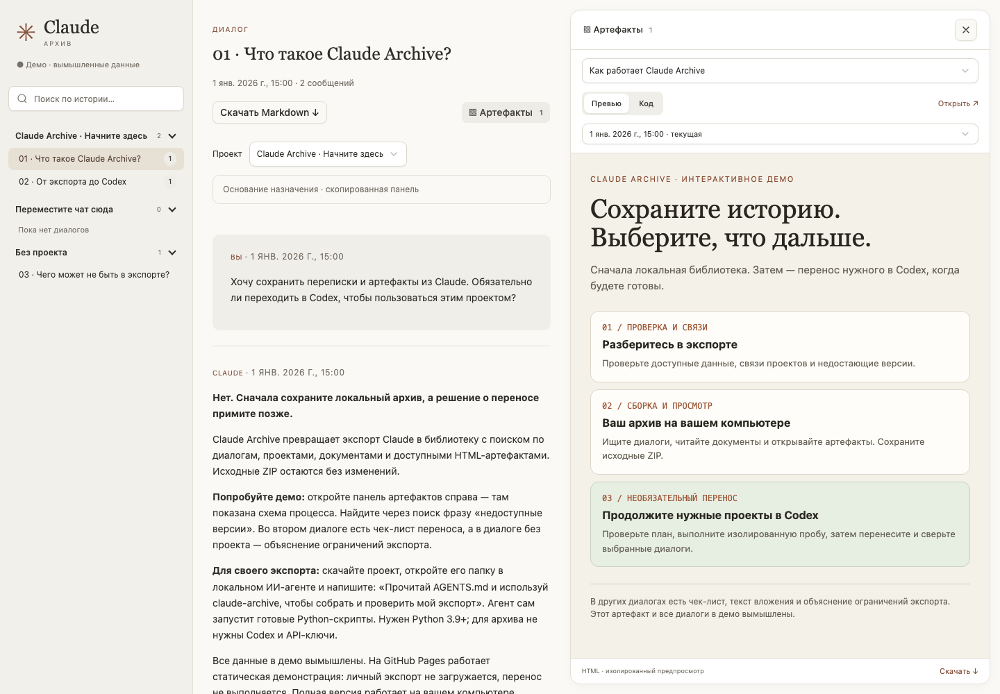

# Claude Archive

Keep your Claude history in a local archive with search, projects, conversations, and artifacts. Optionally transfer selected conversations to Codex.

Open this project in your local AI agent and ask it to do the work. The agent checks your export, helps recover project assignments, builds the archive, and starts the viewer.

**[Try the demo](https://likeleto.github.io/claude-archive/)** · [Download the project](https://github.com/likeleto/claude-archive/archive/refs/heads/main.zip) · [Русский](README.ru.md)

## Get started

1. Download and extract the project.
2. Open its folder in a local AI agent that can read files and run commands.
3. Give it the path to your export and ask:

> Read AGENTS.md. Build and check a local archive of my Claude export in /path/to/export, then open the viewer.

The agent builds the archive and tells you what was preserved and what is missing. If you have project screenshots, copied Claude sidebar text, or notes listing your chats, share those too: they help recover project assignments. The agent asks you to resolve ambiguous matches.

Your computer needs **Python 3.9+**. The agent runs the commands; the skills are included in the project. The archive stays on your computer, and the viewer opens in your browser through a local server started by the agent.

## Don't have your export yet?

On your computer, open Claude **Settings → Privacy → Export data** and wait for the email. See [Claude's instructions](https://support.claude.com/en/articles/9450526-export-your-claude-data).

If the download gives you a `manifest-….json`, give the agent its path and ask:

> Read this manifest JSON and download every listed archive into /path/to/export. Check that the files downloaded completely, then build and open a local archive.

The JSON contains download links. If downloading requires signing in to Claude through a browser, download the ZIPs manually into one private folder. Links expire, so save the files promptly. Keep the original ZIPs outside the public project folder.

## Optionally continue in Codex

After reviewing your archive, ask:

> Prepare a transfer of my selected conversations or projects to Codex. Show me the plan and test it in an isolated history first.

Migration is experimental and requires a compatible Codex CLI. The agent verifies message text and performs the real transfer with your authorization. Open the workspace folders containing project context and artifacts in Codex yourself.

## What to expect

The demo uses fictional data; your own export is processed on your computer. Project assignments, historical versions, and original attachments may be missing from the export; the agent reports these gaps. HTML artifacts run without external network access, so some may not work fully.

[Technical documentation](docs/pipeline.md) · [Manual commands](docs/manual.md) · [Demo publishing](docs/github.md) · [MIT license](LICENSE)

An independent project, not an official Anthropic or OpenAI tool. Basecoat retains its own [MIT license](web/vendor/Basecoat-LICENSE.md).
