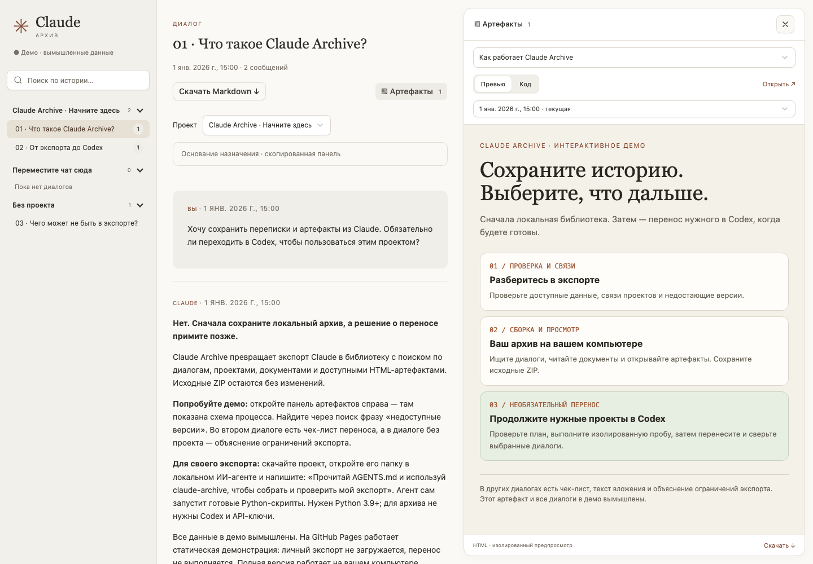

# Claude Archive

Сохраните историю Claude в локальном архиве с поиском, проектами, переписками и артефактами. При желании перенесите выбранные диалоги в Codex.

Откройте проект в своём локальном ИИ-агенте и поручите ему работу: он проверит экспорт, поможет разобраться со связями проектов, соберёт архив и запустит просмотрщик.

**[Открыть демо](https://likeleto.github.io/claude-archive/)** · [Скачать проект](https://github.com/likeleto/claude-archive/archive/refs/heads/main.zip) · [English](README.md)

## Начать

1. Скачайте и распакуйте проект.
2. Откройте его папку в локальном ИИ-агенте с доступом к файлам и запуску команд.
3. Укажите папку с экспортом и напишите:

> Прочитай AGENTS.md. Собери и проверь локальный архив моего экспорта Claude из папки /путь/к/экспорту, затем открой просмотрщик.

Агент выполнит сборку и сообщит, что удалось сохранить и каких данных не хватает. Если у вас остались скриншоты проектов, текст боковой панели Claude или заметки со списками чатов, передайте их тоже — они помогут восстановить назначения. Спорные связи агент уточнит с вами.

На компьютере нужен **Python 3.9+**. Все команды выполняет агент; скиллы уже включены в проект. Готовый архив хранится у вас, а просмотрщик работает в браузере через локальный сервер, который запускает агент.

## Если экспорта ещё нет

В Claude на компьютере откройте **Settings → Privacy → Export data** и дождитесь письма. [Инструкция Claude](https://support.claude.com/en/articles/9450526-export-your-claude-data).

Если по ссылке скачался `manifest-….json`, передайте агенту путь к нему:

> Прочитай этот manifest JSON и скачай все перечисленные архивы в папку /путь/к/экспорту. Проверь, что файлы скачаны полностью, затем собери и открой локальный архив.

JSON содержит ссылки на файлы. Если для скачивания нужен вход в Claude через браузер, скачайте ZIP вручную в одну личную папку. Ссылки временные — сохраните данные сразу. Исходные ZIP храните отдельно от публичного проекта.

## При желании — продолжить в Codex

После просмотра архива попросите:

> Подготовь перенос выбранных диалогов или проектов в Codex. Покажи план и сначала проверь перенос в изолированной истории.

Перенос экспериментальный, нужен совместимый Codex CLI. Агент сверяет тексты сообщений; реальный перенос выполняется с вашим разрешением. Рабочие папки с контекстом проектов и артефактами нужно открыть в Codex самостоятельно.

## Что важно знать

Демо содержит вымышленные данные; личный экспорт обрабатывается на вашем компьютере. В нём могут отсутствовать связи проектов, старые версии и исходные вложения — агент отмечает пропуски. HTML-артефакты открываются без внешней сети, поэтому некоторые могут работать не полностью.

[Техническая документация](docs/pipeline.md) · [Ручные команды](docs/manual.md) · [Публикация демо](docs/github.md) · [MIT-лицензия](LICENSE)

Независимый проект, не официальный инструмент Anthropic или OpenAI. Basecoat распространяется по [собственной MIT-лицензии](web/vendor/Basecoat-LICENSE.md).
